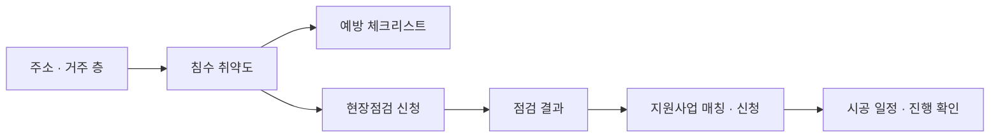
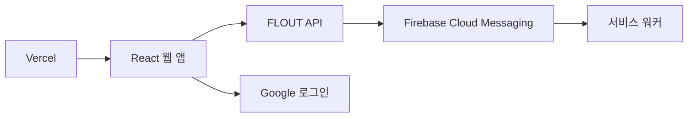
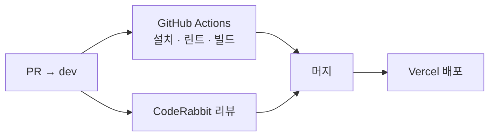

<div align="center">

# 🌊 FLOUT · Resident Web App

**부천시 반지하 주민을 위한 침수 예방 서비스**

<br/>


<br/>

[`flout-resident-webapp.vercel.app`](https://flout-resident-webapp.vercel.app) · 파일럿 지역 **경기도 부천시**

</div>

<br/>

## 📌 목차

1. [서비스 소개](#서비스-소개)
2. [시스템 아키텍처](#시스템-아키텍처)
3. [CI/CD 파이프라인](#cicd)
4. [핵심 구현](#핵심-구현)
5. [연동 API](#연동-api)
6. [화면 구성](#화면-구성)
7. [프로젝트 구조](#프로젝트-구조)
8. [로컬 실행](#로컬-실행)
9. [팀 구성 및 역할](#team)

<br/>

<a id="서비스-소개"></a>

## 🗺️ 서비스 소개

주소와 거주 층을 입력하면 공공데이터를 바탕으로 침수 취약도를 **높음 · 주의 · 낮음**으로 안내합니다. 예방 체크리스트를 확인하고, 현장점검부터 지원사업 신청과 시공까지 진행 상황을 볼 수 있습니다.



<br/>

<a id="시스템-아키텍처"></a>

## 🏗️ 시스템 아키텍처



<br/>

<a id="cicd"></a>

## 🚀 CI/CD 파이프라인



<br/>

<a id="핵심-구현"></a>

## 🔍 핵심 구현

- **인증** · 만료된 액세스 토큰을 갱신한 뒤 원래 요청을 재시도합니다. 동시 요청과 탭 간 중복 갱신을 막습니다.
- **임시저장** · 현장점검과 지원사업 신청서를 서버에 저장해 이어서 작성할 수 있습니다.
- **알림** · FCM으로 진행 상태를 안내하고, 알림을 누르면 관련 화면으로 이동합니다.
- **개발 환경** · API를 목업으로 전환할 수 있고, Figma 디자인 토큰을 Tailwind에서 사용합니다.

<br/>

<a id="연동-api"></a>

## 🔌 연동 API

| 기능 | 대표 경로 |
| --- | --- |
| 인증 | `/auth/login`, `/auth/google`, `/auth/refresh` |
| 주소·취약도 | `/resident/addresses/search`, `/resident/risk-assessments` |
| 예방 가이드 | `/resident/prevention-guides/{guideId}` |
| 현장점검·지원 | `/resident/applications`, `/resident/support-applications` |
| 시공·알림 | `/resident/constructions/{constructionId}`, `/resident/notifications` |

<br/>

<a id="화면-구성"></a>

## 📱 화면 구성

| 화면 | 주요 경로 |
| --- | --- |
| 온보딩·로그인 | `/onboarding`, `/login` |
| 홈·취약도·예방 가이드 | `/`, `/risk/:assessmentId`, `/risk/:assessmentId/guide/*` |
| 현장점검 신청 | `/inspection/apply/*` |
| 내 신청·점검 결과·지원·시공 | `/applications`, `/applications/:applicationId/*` |
| 알림 | `/notifications` |

<br/>

<a id="프로젝트-구조"></a>

## 📁 프로젝트 구조

```text
src/
├── api/          # API 호출, React Query 훅, 목업
├── components/   # 공통 UI와 레이아웃
├── lib/          # HTTP 클라이언트와 공통 유틸
├── pages/        # 기능별 화면
├── routes/       # 라우팅과 화면 목록
├── stores/       # 주소와 신청서 상태
└── styles/       # Tailwind와 디자인 토큰
```

<br/>

<a id="로컬-실행"></a>

## 🛠️ 로컬 실행

Node.js 22가 필요합니다.

```bash
npm install
cp .env.example .env
npm run dev
```

[localhost:5173](http://localhost:5173)에서 확인할 수 있습니다. PowerShell에서는 `cp .env.example .env` 대신 `Copy-Item .env.example .env`를 사용합니다.

백엔드 없이 실행하려면 `.env`에서 `VITE_USE_MOCK=true`를 설정합니다. 목업 로그인은 `resident@example.com` / `password123`입니다.

<details>
<summary><b>환경 변수</b></summary>

| 변수 | 용도 |
| --- | --- |
| `VITE_API_BASE_URL` | API 기본 주소. 예시 `https://api.flout.shop/api` |
| `VITE_USE_MOCK` | 개발 서버에서 목업 사용 |
| `VITE_GOOGLE_CLIENT_ID` | Google 로그인 |
| `VITE_FIREBASE_*`, `VITE_FIREBASE_VAPID_KEY` | Firebase 웹 푸시 |

</details>

빌드는 `npm run build`, 린트는 `npm run lint`로 실행합니다.

<br/>

<a id="개발-규칙"></a>


<a id="team"></a>

## 👥 Team

<table>
  <tr>
    <td align="center" width="25%">
      <a href="https://github.com/essp0521">
        <br/>
        <b>essp0521</b><br/>
        <sub>@essp0521</sub>
      </a>
      <br/><br/>
      <b>Frontend · Setup</b>
      <br/><br/>
      <sub>초기 세팅 · 디자인 토큰 · CI<br/>지원·시공 · 알림</sub>
    </td>
    <td align="center" width="25%">
      <a href="https://github.com/nin0nee">
        <br/>
        <b>nin0nee</b><br/>
        <sub>@nin0nee</sub>
      </a>
      <br/><br/>
      <b>Frontend · Inspection</b>
      <br/><br/>
      <sub>현장점검 · 취약도 API<br/>토큰 재발급 · 구글 로그인</sub>
    </td>
    <td align="center" width="25%">
      <a href="https://github.com/leehn04">
        <br/>
        <b>leehn04</b><br/>
        <sub>@leehn04</sub>
      </a>
      <br/><br/>
      <b>Frontend · Onboarding</b>
      <br/><br/>
      <sub>온보딩 · 주소 검색 · 취약도 결과<br/>예방 가이드 · 현장점검 신청 화면</sub>
    </td>
    <td align="center" width="25%">
      <a href="https://github.com/soletsgooooo">
        <br/>
        <b>soletsgooooo</b><br/>
        <sub>@soletsgooooo</sub>
      </a>
      <br/><br/>
      <b>Frontend · Auth</b>
      <br/><br/>
      <sub>
        자체 로그인 · 회원가입 API 연동
      </sub>
    </td>
  </tr>
</table>

<br/>

<div align="center">
  <sub>🌊 비가 오기 전에, 우리 집 반지하부터.</sub>
</div>
