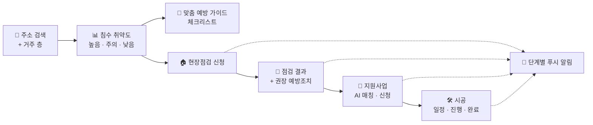
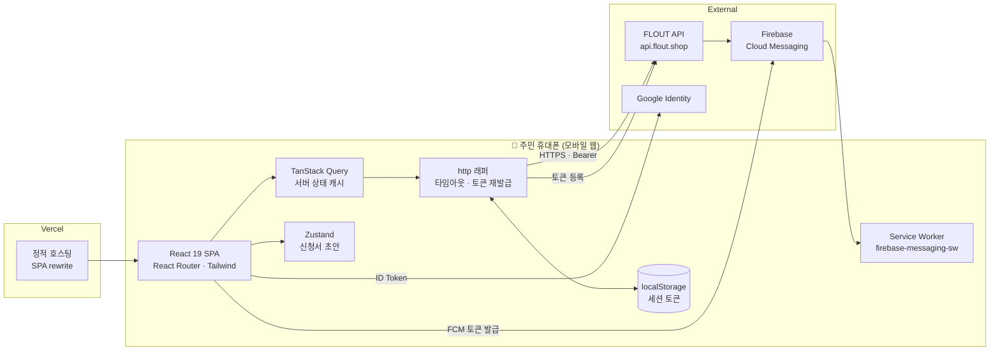
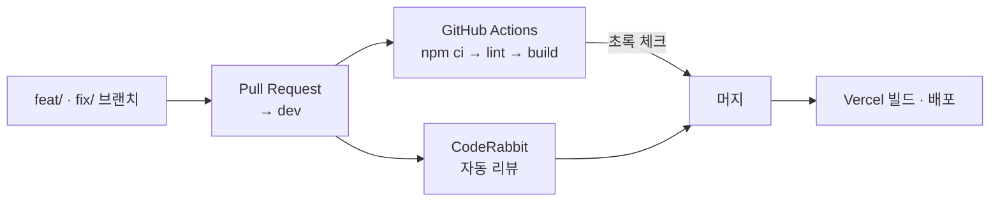
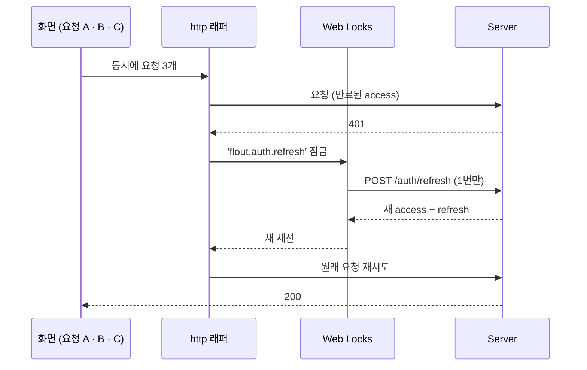

<div align="center">

# 🌊 FLOUT · Resident Web App

**공공데이터로 우리 집 침수 취약도를 확인하고, 현장점검부터 지원 · 시공까지 이어주는 반지하 침수 예방 서비스**

반지하 침수는 한 번이면 생활 전체가 무너집니다.<br/>
FLOUT은 주민이 **주소 하나로 침수 취약도를 확인**하고, **맞춤 예방 가이드**를 따라 준비하며,<br/>
**현장점검 → 지원사업 신청 → 시공**까지 한 앱에서 진행 상황을 확인할 수 있게 돕습니다.

<br/>


<br/>

[`flout-resident-webapp.vercel.app`](https://flout-resident-webapp.vercel.app) · 파일럿 지역 **경기도 부천시** 반지하 가구

</div>

<br/>

## 📌 목차

1. [서비스 한눈에 보기](#️-서비스-한눈에-보기)
2. [시스템 아키텍처](#️-시스템-아키텍처)
3. [CI/CD 파이프라인](#-cicd-파이프라인)
4. [핵심 구현](#-핵심-구현)
5. [연동 API](#-연동-api)
6. [화면 구성](#-화면-구성)
7. [프로젝트 구조](#-프로젝트-구조)
8. [로컬에서 실행하기](#️-로컬에서-실행하기)
9. [개발 규칙](#-개발-규칙)
10. [Team](#-team)

<br/>

## 🗺️ 서비스 한눈에 보기



| 구분 | 내용 |
| --- | --- |
| **취약도 분석** | 주소와 거주 층을 입력하면 공공데이터 기반으로 침수 취약도를 확률(%)이 아닌 **높음 · 주의 · 낮음** 등급으로 보여줍니다. |
| **예방 가이드** | 취약도 결과에 맞춘 예방 가이드를 체크리스트로 제공하고, 항목별 해결 여부를 기록합니다. |
| **현장점검** | 주택 상황 → 방문 희망 일정 → 정보 확인 3단계로 신청하고, 접수 · 방문 · 결과까지 진행 상태를 확인합니다. |
| **지원 · 시공** | 점검 결과로 받을 수 있는 지원사업을 AI가 매칭하고, 신청서 작성 · 서류 제출 · 시공 진행까지 이어집니다. |
| **알림** | 신청 단계가 바뀔 때마다 FCM 푸시를 보내고, 알림을 누르면 해당 화면으로 바로 이동합니다. |

<br/>

## 🏗️ 시스템 아키텍처



- **서버 데이터와 화면 상태를 나눕니다.** API 응답은 TanStack Query가 캐시 · 재시도하고, 여러 화면에 걸친 신청서 입력값만 Zustand에 둡니다.
- **모든 API 호출은 `src/lib/http.ts` 하나를 거칩니다.** 인증 헤더, 타임아웃, 에러 문구, 토큰 재발급이 한곳에 모여 있습니다.
- **백엔드 없이도 개발할 수 있습니다.** `VITE_USE_MOCK=true`면 개발 서버에서 목업 데이터로 전체 흐름이 동작합니다.

<br/>

## 🚀 CI/CD 파이프라인



| 단계 | 내용 |
| --- | --- |
| **CI** | 모든 PR에서 `npm ci` → ESLint → `tsc -b && vite build`. 목업 모드로 빌드해 백엔드 상태와 무관하게 검증합니다. |
| **리뷰** | CodeRabbit이 PR마다 자동 리뷰를 남기고, PR 템플릿에 Figma 노드 · 기능명세 ID · 모바일 스크린샷을 첨부합니다. |
| **배포** | Vercel 정적 호스팅. SPA 라우팅을 위해 모든 경로를 `index.html`로 rewrite합니다 (`vercel.json`). |

<br/>

## 🔍 핵심 구현

### 🔐 토큰 자동 재발급 &nbsp;<sub>by [@nin0nee](https://github.com/nin0nee)</sub>

**access token이 만료돼 401이 오면, 사용자 모르게 재발급하고 원래 요청을 다시 보냅니다.**



- **재발급은 한 번만**: 동시에 401이 여러 개 와도 같은 Promise를 공유하고, `navigator.locks`로 **여러 탭이 동시에 재발급하는 것까지** 막습니다.
- **응답을 그대로 믿지 않습니다**: 재발급 결과가 주민(`RESIDENT`) 계정인지, refresh token이 실제로 바뀌었는지 확인합니다.
- **세션이 바뀌면 캐시를 비웁니다**: 로그아웃 · 다른 계정 로그인 시 React Query 캐시를 초기화해 이전 사용자 데이터가 보이지 않습니다.
- 재발급이 401로 실패하면 토큰을 지우고 로그인 화면으로 보냅니다.

### 🌐 fetch 래퍼 · 에러 처리 &nbsp;<sub>by [@essp0521](https://github.com/essp0521)</sub>

- **타임아웃 15초**를 `AbortController`로 직접 구현했습니다. `AbortSignal.timeout`이 없는 **iOS 17.4 미만 기기**를 고려했습니다.
- 네트워크 끊김 · 타임아웃 · 서버 에러를 `ApiError(status, message, code)`로 통일해, 화면은 `error.message`만 보여주면 됩니다.
- **4xx와 재발급 실패는 재시도하지 않고**, 5xx · 네트워크 오류만 최대 2번 재시도합니다.
- 사진 · 서류 업로드는 `FormData`를 그대로 보내 브라우저가 `boundary`를 붙이게 합니다.

### 🧪 목업 모드 &nbsp;<sub>by [@essp0521](https://github.com/essp0521)</sub>

```ts
withMock(
  () => mockApplication,                       // VITE_USE_MOCK=true
  () => http.get(`/resident/applications/${id}`), // 실제 API
);
```

- 모든 API 훅이 `withMock()`을 거쳐, 환경 변수 하나로 목업 ↔ 실제 API를 바꿉니다. 운영 빌드에서는 항상 실제 API를 씁니다.
- 목업 데이터는 Figma 예시 문구를 그대로 써서 **디자인 대조가 쉽습니다.**
- `/__screens`에서 전체 화면 목록(구현 여부 · 경로 · Figma 링크)을 보고 바로 이동할 수 있습니다.

### 📝 신청서 임시저장 &nbsp;<sub>by [@nin0nee](https://github.com/nin0nee) · [@essp0521](https://github.com/essp0521)</sub>

- 현장점검 신청(3단계)과 지원사업 신청서는 작성 중인 내용을 **서버에 임시저장**해, 앱을 닫았다 열어도 이어서 작성할 수 있습니다.
- 서버 응답의 `draftId` · `version` · 필드 형식을 검증한 뒤에만 화면에 반영합니다.

### 🔔 푸시 알림 (FCM) &nbsp;<sub>by [@essp0521](https://github.com/essp0521)</sub>

- Firebase SDK는 **알림 권한을 요청할 때만 동적 import**해 첫 화면 번들에 포함되지 않습니다.
- 서비스 워커(`firebase-messaging-sw.js`)로 앱이 꺼져 있어도 알림을 받고, 발급한 토큰은 `PUT /notifications/tokens`로 등록합니다.
- 알림 종류(점검 접수 · 방문 · 결과 · 지원 · 시공)마다 이동할 화면을 연결했습니다.

### 🎨 디자인 시스템 → Tailwind 토큰 &nbsp;<sub>by [@essp0521](https://github.com/essp0521) · [@nin0nee](https://github.com/nin0nee)</sub>

- Figma 주민용 디자인 시스템의 색상 11 · 타이포 8 · radius · 레이아웃 값을 `@theme` 토큰으로 1:1 매핑했습니다. **hex 값을 직접 쓰지 않습니다.**
- 위험 · 주의 · 완료는 **색 + 상태명 + 아이콘**을 함께 표시해 색만으로 정보를 전달하지 않습니다.

<details>
<summary><b>토큰 표</b></summary>

| Figma | Tailwind | 값 |
| --- | --- | --- |
| color/primary · onPrimary | `bg-primary` `text-on-primary` | #234F73 · #FFF |
| color/page · surface · soft | `bg-page` `bg-surface` `bg-soft` | #F4F5F6 · #FFF · #EEF3F7 |
| color/ink · body · muted · border | `text-ink` `text-body-text` `text-muted` `border-border` | #202B36 · #43515E · #596672 · #C8D0D7 |
| color/danger · warning · success | `text-danger` `text-warning` `text-success` | #A53632 · #865A16 · #27654D |
| Risk / Title / Heading / Section | `text-risk` `text-title` `text-heading` `text-section` | 30 · 26 · 20 · 16px Bold |
| Body / Label / Caption / Button | `text-body` `text-label` `text-caption` `text-button` | 14 Reg · 14 Med · 13 Reg · 16 Bold |
| radius 4 · 6 · 8 · 12 | `rounded-sm` `rounded-md` `rounded-lg` `rounded-xl` | 썸네일 · 버튼/입력/카드 · 신청 CTA · 바텀시트 |
| 좌우 여백 20 · 헤더 56 | `px-gutter` `h-header` | |

> Figma의 `color/body`는 타이포 `Body`와 이름이 겹쳐 `text-body-text`로 바꿨습니다 (`text-body` = 14px 본문 크기).
</details>

<br/>

## 🔌 연동 API

> Base URL: `VITE_API_BASE_URL` (예: `https://api.flout.shop/api`)

| 도메인 | 경로 | 설명 |
| --- | --- | --- |
| **Auth** | `/auth/signup` · `/auth/login` · `/auth/google` | 자체 회원가입 · 로그인 · 구글 로그인 |
| | `/auth/refresh` · `/auth/logout` | 토큰 재발급 · 로그아웃 |
| | `/resident/consents` | 정보 제공 동의 |
| **Home** | `/resident/progress` | 홈 진행 현황 · 전체 보기 |
| **Risk** | `/resident/addresses/search` · `/coordinates` | 주소 검색 · 좌표 조회 |
| | `/resident/risk-assessments` | 침수 취약도 분석 · 결과 |
| **Guide** | `/resident/prevention-guides/{guideId}` · `/resolution` | 예방 가이드 · 해결 여부 |
| | `/resident/guide-items/{itemId}/progress` | 체크리스트 항목 진행 |
| **Inspection** | `/resident/applications` · `/{applicationId}` | 현장점검 신청 · 목록 · 상세 |
| | `/resident/applications/drafts` · `/resident/application-form-drafts/{draftId}` | 신청서 임시저장 |
| | `/resident/applications/{id}/result` · `/recommendations` · `/recommended-facilities` | 점검 결과 · 권장 예방조치 · 시설 |
| **Support** | `/resident/support-application/{id}/matching` | 지원사업 AI 매칭 |
| | `/resident/support-applications` · `/{id}/review` · `/attachments` | 지원 신청 · 검토 · 서류 |
| | `/resident/support-applications/drafts` · `/resident/support-form-drafts/{draftId}` | 지원 신청서 임시저장 |
| **Construction** | `/resident/constructions/{constructionId}` · `/schedule` | 시공 진행 · 일정 |
| **Notification** | `/resident/notifications` · `/read-all` · `/unread-status` | 알림 목록 · 모두 읽음 · 안 읽음 여부 |
| | `/notifications/tokens` | FCM 토큰 등록 |

<details>
<summary><b>공통 응답 형식</b></summary>

```json
{ "isSuccess": true, "status": 200, "code": "...", "message": "...", "result": { } }
```

`isSuccess`가 `false`거나 `result`가 없으면 `ApiError`로 바꿔 던집니다.
</details>

<br/>

## 📱 화면 구성

전체 매핑(Figma 노드 ↔ 경로 ↔ 기능명세 ID)은 [`src/routes/screens.ts`](src/routes/screens.ts), 개발 서버의 `/__screens`에서 확인할 수 있습니다.

| 그룹 | 경로 | 기능명세 |
| --- | --- | --- |
| 진입 | `/onboarding` `/login` `/signup` `/consent` | |
| 홈 · 취약도 | `/` `/home/progress` `/address/*` `/risk/:assessmentId` | RISK-01~06, 08, 09 |
| 예방 가이드 | `/risk/:assessmentId/guide/*` | RISK-07 |
| 현장점검 신청 | `/inspection/apply/*` `/inspection/complete/:applicationId` | INSPECTION-01~10 |
| 내 신청 | `/applications` `/applications/:applicationId/*` | STATUS-01~06 |
| 점검 결과 | `/applications/:applicationId/result/*` | RESULT-01~08 |
| 지원 | `/applications/:applicationId/support/*` | SUPPORT-01~09 |
| 시공 | `/applications/:applicationId/construction/*` | CONSTRUCTION-01~07 |
| 알림 | `/notifications` | NOTI-01~08 |

- 기획 · 기능명세: Notion `술제술제 › 기능명세서`
- 디자인: [Figma › 주민용 최종디자인](https://www.figma.com/design/vGHXBD128aui75dvqLXEbP/FLOUT?node-id=1115-2380) · [주민용 디자인 시스템](https://www.figma.com/design/vGHXBD128aui75dvqLXEbP/FLOUT?node-id=1162-561)

<br/>

## 📁 프로젝트 구조

```
src
├── api                    # 도메인별 API 함수 + React Query 훅, 목업
│   ├── auth · authMock    # 이메일 · 구글 로그인, 동의, 목업 세션
│   ├── risk · riskAnalysis · preventionGuide   # 주소 · 취약도 · 예방 가이드
│   ├── applications · inspectionResults        # 현장점검 · 결과 · 지원 · 시공
│   ├── inspectionFormDrafts · supportFormDrafts # 신청서 임시저장
│   ├── residentProgress · notifications        # 홈 진행 현황 · 알림 · FCM
│   ├── queryClient        # QueryClient, queryKeys, withMock()
│   └── mocks              # VITE_USE_MOCK=true 일 때 쓰는 데이터
├── components
│   ├── ui                 # 디자인 시스템 컴포넌트 (Button, BottomSheet, StatusText …)
│   ├── layout             # AppLayout, AppHeader, Screen(헤더 + 본문 + 하단 CTA)
│   └── dev                # ScreenPlaceholder
├── constants              # paths(라우트 경로) · labels(상태 코드 → 문구 · 색)
├── lib                    # http 래퍼, env, storage, 날짜 · 주소 유틸, hooks
├── pages/<도메인>          # 1 화면 = 1 파일
├── routes                 # router, screens(Figma ↔ 라우트 ↔ 기능명세)
├── stores                 # Zustand (주소 · 현장점검 · 지원 신청 초안)
├── styles/index.css       # Tailwind + 디자인 토큰
└── types/domain.ts        # 기능명세 기반 도메인 타입

public/firebase-messaging-sw.js   # FCM 백그라운드 알림
.github                           # PR · 이슈 템플릿, CI
vercel.json                       # SPA rewrite
```

<br/>

## 🛠️ 로컬에서 실행하기

**필요한 것**: Node.js 22 (`.nvmrc`, 최소 20)

```bash
# 1. 의존성 설치
npm install

# 2. 환경 변수 (VITE_USE_MOCK=true 면 백엔드 없이 목업으로 동작)
cp .env.example .env

# 3. 개발 서버 → http://localhost:5173 (같은 와이파이 휴대폰은 Network 주소로 접속)
npm run dev
```

목업 로그인 계정: `resident@example.com` / `password123`

<details>
<summary><b>환경 변수</b></summary>

| 이름 | 설명 | 없으면 |
| --- | --- | --- |
| `VITE_API_BASE_URL` | 백엔드 API 주소 (끝에 `/` 없이, `/api` 포함) | 실제 API 호출 불가 |
| `VITE_USE_MOCK` | 개발 서버에서 `true`면 목업 사용. 운영 빌드는 항상 실제 API | 실제 API 사용 |
| `VITE_GOOGLE_CLIENT_ID` | Google Identity 웹 클라이언트 ID | 구글 로그인 불가 |
| `VITE_FIREBASE_*` | Firebase 웹 앱 설정 (API_KEY, AUTH_DOMAIN, PROJECT_ID, STORAGE_BUCKET, MESSAGING_SENDER_ID, APP_ID) | 푸시 알림만 비활성 |
| `VITE_FIREBASE_VAPID_KEY` | FCM 웹 푸시 VAPID 키 | 푸시 알림만 비활성 |

환경 변수를 바꾼 뒤에는 개발 서버를 다시 시작하세요.
</details>

<details>
<summary><b>스크립트</b></summary>

| 스크립트 | 설명 |
| --- | --- |
| `npm run dev` | 개발 서버 |
| `npm run build` | 타입체크 + 프로덕션 빌드 (`dist/`) |
| `npm run preview` | 빌드 결과 미리보기 |
| `npm run lint` | ESLint |
| `npm run typecheck` | TypeScript 타입체크만 |
| `npm run format` | Prettier (Tailwind 클래스 정렬 포함) |
| `npm run test:auth` | 인증 로직 테스트 |
</details>

<br/>

## 📏 개발 규칙

- **브랜치**: `dev` 기준으로 `feat/…`, `fix/…`, `refactor/…`, `chore/…` 브랜치를 따고 PR로만 머지합니다. 머지 후 브랜치 삭제.
- **커밋**: `feat:` `fix:` `refactor:` `style:` `chore:` `docs:` + 한국어 요약 (예: `feat: 현장점검 신청 1단계 화면`)
- **PR 라벨**: 브랜치 접두어와 맞춥니다 (`✨ FEAT` · `🐛 FIX` · `♻️ REFACTOR` · `🔧 CHORE`). API 연동이 있으면 `🔗 API`를 함께 붙입니다.
- **PR**: 템플릿에 Figma 노드 링크 + 기능명세 ID + 모바일 스크린샷을 첨부합니다.
- **코드**
  - import는 `@/` 절대경로, 컴포넌트 파일명 PascalCase, 훅은 `useXxx`
  - 색은 hex 대신 토큰 클래스, UI는 `@/components/ui` 컴포넌트 사용
  - 페이지 이동은 `navigate(generatePath(PATHS.xxx, { applicationId }))` — 경로 문자열을 직접 쓰지 않습니다
  - 상태 문구(접수 · 검토 중 · 승인 등)는 `src/constants/labels.ts`에서 가져옵니다
  - `node_modules`, `.env`는 커밋하지 않습니다

<br/>

## 👥 Team

<table>
  <tr>
    <td align="center" width="25%">
      <a href="https://github.com/essp0521">
        <br/>
        <b>essp0521</b><br/>
        <sub>@essp0521</sub>
      </a>
      <br/><br/>
      <b>Frontend · Setup</b>
      <br/><br/>
      <sub>
        프로젝트 초기 세팅 · 디자인 토큰 · CI<br/>
        지원 · 시공 · 내 신청 화면 및 API 연동<br/>
        지원사업 AI 매칭 · 신청서 임시저장<br/>
        FCM 푸시 · 알림 · 로그아웃
      </sub>
    </td>
    <td align="center" width="25%">
      <a href="https://github.com/nin0nee">
        <br/>
        <b>nin0nee</b><br/>
        <sub>@nin0nee</sub>
      </a>
      <br/><br/>
      <b>Frontend · Inspection</b>
      <br/><br/>
      <sub>
        현장점검 진행 · 결과 · 권장 예방조치<br/>
        홈 진행 현황 · 취약도 분석 · 예방 가이드 API<br/>
        주소 검색 · 좌표 조회 API<br/>
        토큰 자동 재발급 · 구글 로그인
      </sub>
    </td>
    <td align="center" width="25%">
      <a href="https://github.com/leehn04">
        <br/>
        <b>leehn04</b><br/>
        <sub>@leehn04</sub>
      </a>
      <br/><br/>
      <b>Frontend · Onboarding</b>
      <br/><br/>
      <sub>
        온보딩 · 로그인 · 회원가입 · 동의 화면<br/>
        홈 · 주소 검색 화면<br/>
        침수 취약도 결과 · 예방 가이드 화면<br/>
        현장점검 신청 화면
      </sub>
    </td>
    <td align="center" width="25%">
      <a href="https://github.com/soletsgooooo">
        <br/>
        <b>soletsgooooo</b><br/>
        <sub>@soletsgooooo</sub>
      </a>
      <br/><br/>
      <b>Frontend · Auth</b>
      <br/><br/>
      <sub>
        자체 로그인 · 회원가입 API 연동
      </sub>
    </td>
  </tr>
</table>

<br/>

<div align="center">
  <sub>🌊 비가 오기 전에, 우리 집 반지하부터.</sub>
</div>
